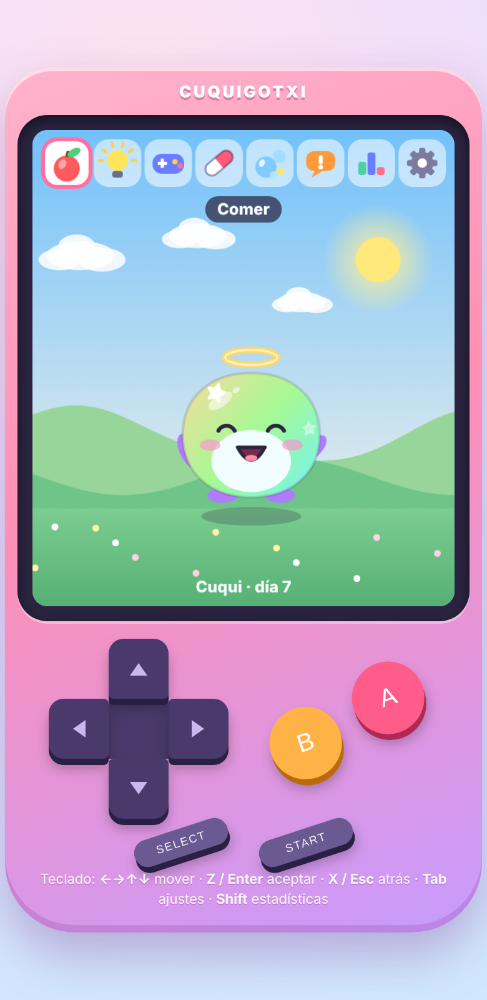

# 🥚 Cuquigotxi

Una mascota virtual **moderna** con todas las funciones clásicas del Tamagotchi, dibujada con gráficos vectoriales suaves (gradientes, brillos y animaciones) en lugar de píxeles. Sin dependencias: HTML + CSS + JavaScript puro, funciona offline y se puede instalar como app (PWA).



## Cómo jugar

Abre `index.html` en el navegador (o sírvelo con cualquier servidor estático, p. ej. `python3 -m http.server`).

### Controles

| Acción | Teclado | Mando en pantalla (móvil, vertical) |
|---|---|---|
| Mover selección | `←` `→` `↑` `↓` (o `WASD`) | Cruceta |
| Aceptar / calentar huevo | `Z`, `Enter`, `Espacio` | **A** |
| Atrás / cancelar | `X`, `Esc`, `Backspace` | **B** |
| Ajustes | `Tab` | **START** |
| Estado (estadísticas) | `Shift` | **SELECT** |

## Funciones

**Clásicas**
- 🥚 Huevo que hay que calentar hasta que eclosiona
- 🍎 Alimentar: comida (hambre) o dulces (felicidad, pero engordan y enferman)
- ❤️ Medidores de hambre, felicidad y salud, además de peso, edad y disciplina
- 💩 Cacas que hay que limpiar (si no, se enferma)
- 💊 Enfermedad: necesita **2 dosis** de medicina
- 💡 Luz y sueño: duerme de noche (22:00–07:00) y hay que apagar la luz
- 🎮 Minijuegos: *¿Izquierda o derecha?* y *Atrapa estrellas*
- 📣 Disciplina: regaña las falsas alarmas para que se porte bien
- 🔔 Llamadas de atención; ignorarlas suma **errores de cuidado**
- 🧬 Evolución por etapas (Bebé → Niño → Joven → Adulto → Senior) con 10 criaturas distintas según cómo lo cuides, incluida una secreta (cuidado perfecto)
- 👻 Puede morir (hambre, enfermedad o vejez) y empezar de nuevo con otro huevo

**Modernas**
- Gráficos vectoriales con animaciones, partículas y escenario con ciclo día/noche real
- Mascota que sigue viva aunque cierres la pestaña (se simula el tiempo transcurrido)
- Guardado automático (localStorage), nombre personalizable, sonidos sintetizados, vibración en móvil
- Velocidad ajustable (1x / 4x / 16x / 60x) en Ajustes, PWA instalable y funcionamiento offline

## Estructura

```
index.html        pantalla y mando
style.css         carcasa y diseño responsive
js/game.js        reglas y simulación
js/sprites.js     dibujo de criaturas, objetos e iconos
js/ui.js          render, menús, minijuegos y controles
js/audio.js       efectos de sonido (WebAudio)
```

## Licencia

MIT
